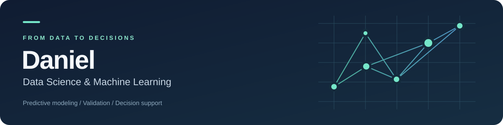

  

  <b>Predictive Modeling · Temporal Validation · Decision Support</b> 
  데이터로 문제를 정의하고, 검증 가능한 예측을 실제 의사결정으로 연결합니다.

  <a href="https://daniel5781.github.io/7Eleven_MD_Dashboard/">대시보드 체험</a> ·
  <a href="https://github.com/daniel5781/khu-subapp">산업연관분석 코드</a> ·
  <a href="#selected-projects">프로젝트 보기</a>

## Selected Projects

| 프로젝트 | 해결하려는 문제와 접근 | 공개 자료 |
| --- | --- | --- |
| **세븐일레븐 재고 최적화** | 신상품 초도발주 예측·검증과 재고 시뮬레이션을 MD 의사결정 화면으로 연결 | [데모](https://daniel5781.github.io/7Eleven_MD_Dashboard/) · [코드](https://github.com/daniel5781/7Eleven_MD_Dashboard) · [소개](projects/inventory.md) |
| **산업연관분석** | 산업 간 상호의존성과 파급효과를 Leontief 모형·네트워크로 분석 | [코드](https://github.com/daniel5781/khu-subapp) · [기여와 설계](projects/industrial-network.md) |
| **LG Aimers** | 투구 전 상황과 선수 이력 기반 제구 성공 확률 예측, 앙상블·확률 보정·제출 검증 | [프로젝트 소개](projects/lg-aimers.md) · 코드 비공개 |
| **황색포도상구균 검출확률 예측** | 희소한 양성 검사 이력에서 위험도를 추정하고 검사 우선순위 평가 | [프로젝트 소개](projects/food-safety.md) · 코드 비공개 |

### 재고 예측에서 의사결정까지

**세븐일레븐 팀 프로젝트에서 PM, 데이터 전처리, 예측 모델 검증, 재고 시뮬레이션, 대시보드 구현을 담당했습니다.**

예약 수요와 상품·센터별 특성을 검토하고, 추천 발주량을 사용자가 조정하는 흐름으로 연결했습니다.
[공개 데모](https://daniel5781.github.io/7Eleven_MD_Dashboard/)에서는 상품 상세, 예약 추이, 추천량 검토, 센터별 배분과 과거 상품 조회를 체험할 수 있습니다.
공개 화면의 모든 상품·센터·수치는 합성 예시이며 실제 모델 성능이나 운영 실적을 뜻하지 않습니다.
최종 대시보드의 [팀 원본과 출처](https://github.com/Geonhohoho/7Eleven_MD_Dashboard)를 함께 표기했습니다.

### 코드로 확인하는 산업연관분석 기여

공개 팀 프로젝트를 확장하며 분석 로직과 데이터 연계 구조를 개선했습니다.

- **Leontief 급수 기반 네트워크 구성** — [구현 커밋](https://github.com/daniel5781/khu-subapp/commit/b3cea1690d8621b363185f419390727fa3f967ae)
- **미국 BEA 데이터 모드와 수집 경로 연계** — [구현 커밋](https://github.com/daniel5781/khu-subapp/commit/d0fb47186ef5712e766545ae6ba7e68ed4711132)
- **분석 라이브러리 모듈 분리** — [구현 커밋](https://github.com/daniel5781/khu-subapp/commit/5bdd59f838855c06b6811d9447c68483a7085198)

## How I Work

**문제 정의 → 데이터 전처리 → 검증 → 의사결정 연결**

- 예측 시점에 알 수 있는 정보만 사용하고 시간에 따른 데이터 누수를 점검합니다.
- 모델 점수와 운영 의사결정 지표를 구분해 평가합니다.
- 채택한 실험뿐 아니라 효과가 없었던 실험과 재현 조건도 기록합니다.
- 개인 기여, 팀 결과, 공개 데모의 범위를 구분해 설명합니다.

## Toolkit

| 영역 | 도구 |
| --- | --- |
| Data | Python · SQL · pandas · NumPy |
| Modeling | scikit-learn · LightGBM · CatBoost · FT-Transformer |
| Analysis & Applications | Streamlit · NetworkX · Matplotlib · React |
| Workflow | Git · Jupyter · 실험 기록 · 시계열 검증 |

<b>Other Work</b>

- **LLM-based Financial Assistant** — 금융 도메인 질의응답 프로토타입, GPT-3 fine-tuning과 RAG 접근 비교.
- **Weather & Traffic Accident Prediction** — 기상·교통 데이터를 결합한 지역별 사고 패턴 분석과 예측 실험.
- **Generative AI Advertisement Prototype** — 생성형 이미지, 객체 탐지, 텍스트 배치 영역 탐색을 결합한 광고 제작 실험.

기업 협력·대회·연구 프로젝트의 원자료와 비공개 코드는 공개하지 않습니다. 공개 소개는 문제 정의, 기술적 접근, 개인 기여와 검증 관점에 한정합니다.
